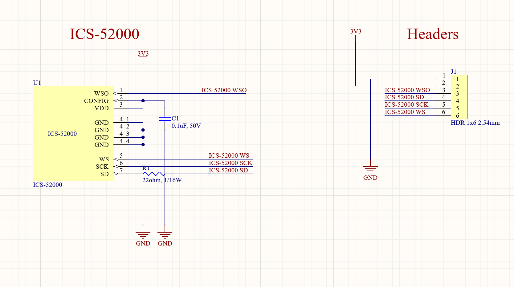
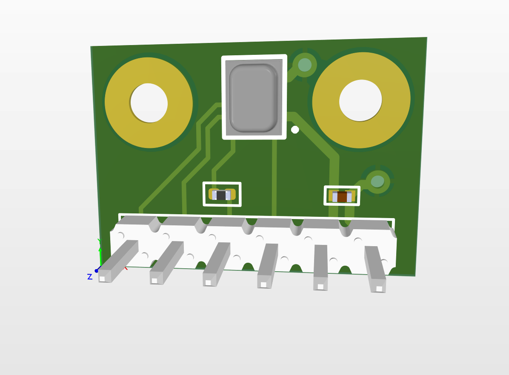
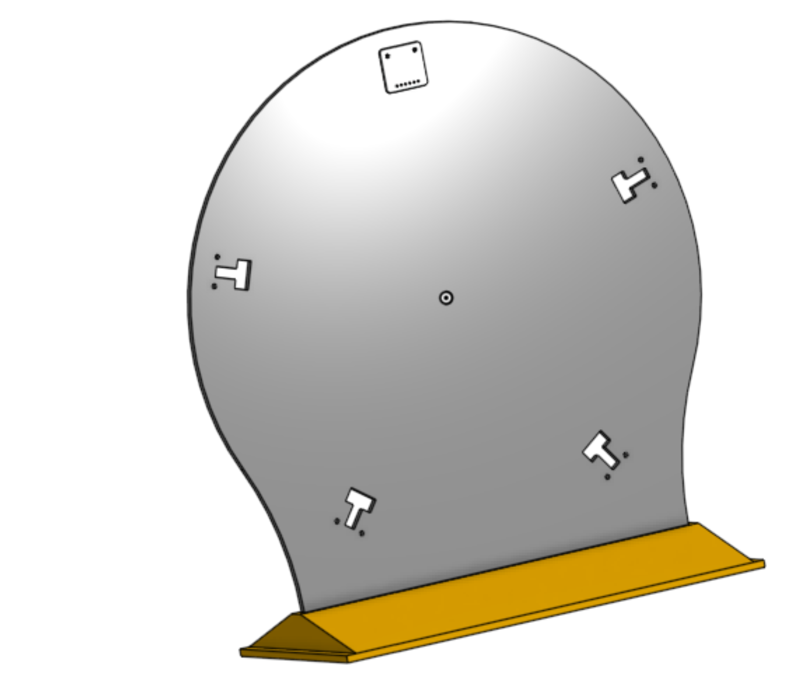
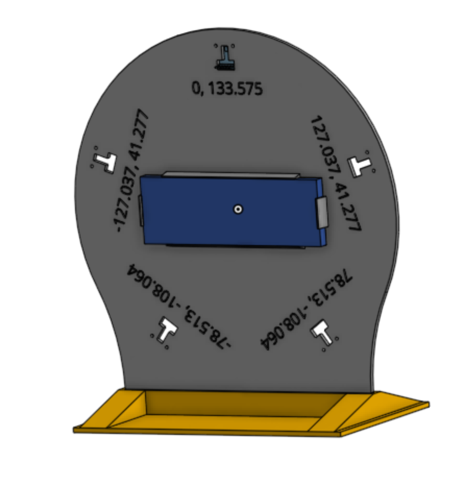

# Hardware

## ICS-52000

The ICS-52000 MEMS microphone was chosen because of the industry standard 24-bit
TDM interface. The interface is made specifically for microphone arrays because
of the ability to connect up to 16 microphones in a daisy chain that all share the same
clock. This allows for easier scaling without worrying about the critical issue
of clock synchronization.

#### Breakout Board

Own custom PCB breakoutboard was created since no ICS-52000 breakoutboard is
available on the marked.
| Schematic | PCB |
|---|---|
|  |  |

#### Downsides

NOTE! This microphone has lifecycle status NRND (Not Recommended for New Designs). The microphone was still chosen bacause of the sparse selection of microphones with TDM interface and its cheap price.

For future iterations sensiBel MEMS microphone is an upper class option.

## NUCLEOH723ZG

The NUCLEOH723ZG was chosen because it ticks all the boxes for a good first
prototype. The SAI interface is used to transfer data from the microphone to
the MCU. MPU, DMA and DTCM are also usefule features for efficient calculations
and data transfers.

#### Downsides

The SAI can only connect to 8 microphones instead of the preffered 16
microphones. We also suspect that the higly computational SRP-PHAT algorithm
will give us issues with space in memory with future scaling.

## Stand

For this prototype a 5 microphone flat circular array is chosen. Precise
placement of microphones is very important for calculating DOA (Direction Of Arrival).

| Front | Rear |
|---|---|
|  |  |
